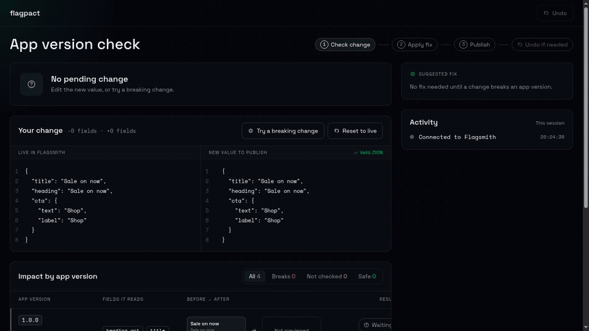
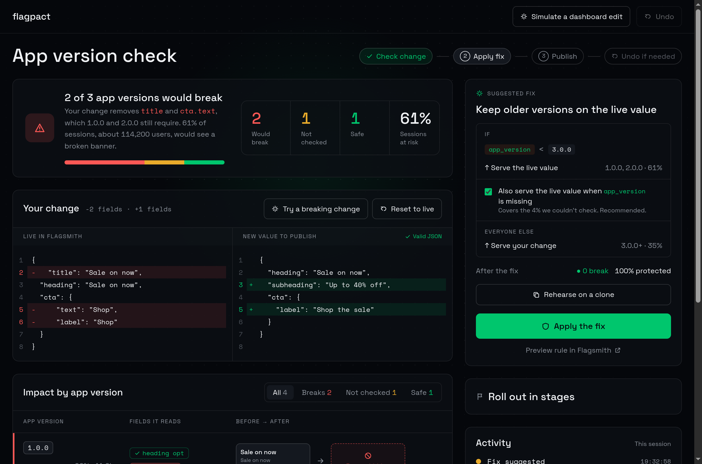
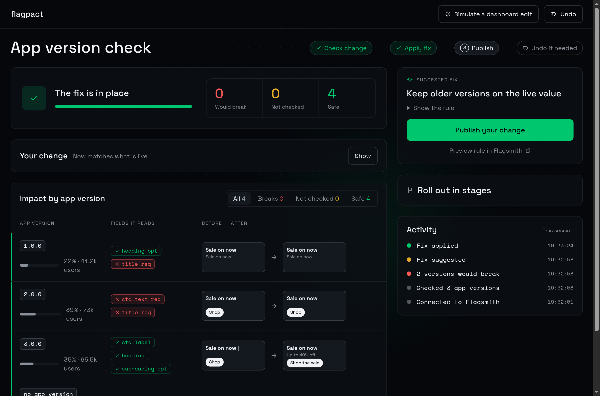
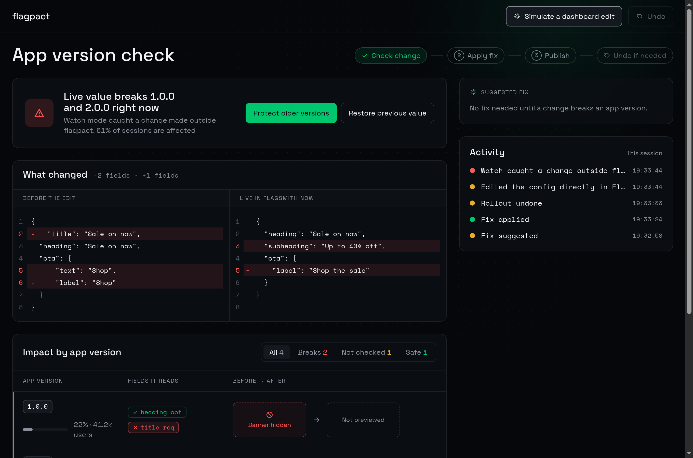
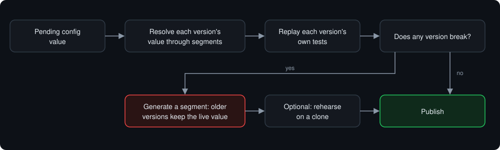

# flagpact

<p>
  <a href="https://github.com/Nithinaug/flagpact/actions/workflows/ci.yml"></a>
  <a href="https://github.com/Nithinaug/flagpact/actions/workflows/live-flagsmith.yml"></a>
  <a href="LICENSE"></a>
  <a href="https://pypi.org/project/flagpact/"></a>
  <a href="https://github.com/Nithinaug/flagpact/releases"></a>
  
  
</p>

Check a Flagsmith config change against every app version before you publish it.

A Flagsmith remote-config value changes, and the apps that read it get the new value at once, with no redeploy. That is the point of remote config. It also means an old build still in people's hands, one that expects the old shape, can crash the moment you save. flagpact tells you which app versions would break before the change goes live, and fixes it by keeping those versions on the previous value.

It answers one question: will this change break an app version that is already in people's hands, and if so, what keeps that version safe?

Built for the Flagsmith "Toggle Wars" hackathon, Track 03 (Build on Open Source Flagsmith) and Track 04 (Flagsmith Agent Skills). It works with self-hosted Flagsmith and has been tried on 2.294.0.



## See it work

**1. Check a change.** Two of three app versions would break, with the users at risk and the rule that fixes it.



**2. Apply the fix.** Older versions stay on the live value, so nothing breaks and the change is ready to publish.



**3. Watch for outside edits.** If someone edits the value in the Flagsmith dashboard and breaks a version, the alert says which versions and offers to protect them or restore the last safe value.



## What it does

- **Records what each app version reads.** Run an app version's own tests once. flagpact records which JSON fields they read, which are required and what types they expect. That is the version's contract.
- **Checks a pending value against every version.** Edit the new value in the console, or pass it to `flagpact check`. flagpact resolves which value each version would get through Flagsmith's segments, then replays each version's own tests against it.
- **Shows what each version would display.** The live app previews show the real banner for each version, or a crash.
- **Fixes the break.** It creates a Flagsmith segment on the `app_version` trait that keeps older versions on the previous value, then you publish the change for everyone else.

<p align="center">
  
</p>

Also included:

- **Rehearses on a clone.** Before anything touches your environment, it clones the environment through Flagsmith's API, applies and publishes the fix there, probes each version, and deletes the clone.
- **Watches for edits made outside flagpact.** If someone changes the value in the Flagsmith dashboard and it breaks a version, flagpact shows what changed and offers "Protect older versions" or "Restore previous value".
- **Rolls out in stages.** Instead of one publish, it can give the new value to the newest app version first, then the next one down, re-checking every version before each stage. You can step back one stage at a time.
- **Runs in CI.** `flagpact check` and a GitHub Action fail the build when a pending value would break a version.
- **Imports a public GitHub repository.** It reads the code without running it, finds the Flagsmith config reads and app versions, and drafts a `flagpact.json`.

## Why not just a segment?

Flagsmith can already keep old app versions on an old value. A segment on `app_version` with an override does it, and you can build one in the dashboard. What Flagsmith cannot tell you is which versions need it.

- **It knows what each version expects.** Flagsmith has no way to know what a shipped app version reads from a config value. flagpact learns that from each version's own tests and replays them against the new value.
- **You get the answer before you publish.** Which versions would break, and how many users are on them when you supply version shares.
- **It builds the fix.** If something would break, flagpact creates the segment and the override first and changes the default after, so no old version ever sees the new value.
- **It keeps watching.** After a publish, an outside edit that breaks a version is caught, and the last safe value can be restored.

## Install

```bash
pip install flagpact
```

This gives you the `flagpact` command (`check` and `import`) and `flagpact-server`, the local console, which needs a Flagsmith on your own machine. For the one-command demo with its own Flagsmith, use the Quick start below.

## Quick start

You need Docker, Python 3.10 or newer, and Node 22 (only to build the console).

```bash
bash scripts/demo.sh
```

This starts a self-hosted Flagsmith and its database in Docker, creates an organisation, project and environment, seeds the `home_banner` config, installs flagpact, builds the console and starts it.

- Console: http://127.0.0.1:8765
- Demo controls: http://127.0.0.1:8765/demo (adds a button that simulates an edit made in the Flagsmith dashboard)
- Flagsmith: http://127.0.0.1:8000

If those ports are taken, set `FLAGSMITH_PORT` before the first run and `FLAGPACT_PORT` when starting.

The Flagsmith stack listens on 127.0.0.1 only. Secrets are generated at random into `stack/.env` and `.flagpact-keys.env`, both git-ignored.

To reset the demo value at any time:

```bash
.venv/bin/python scripts/seed.py .flagpact-keys.env
```

## Using the console

1. Open the console. It shows three demo app versions, 1.0.0, 2.0.0 and 3.0.0, with what each one reads.
2. Click "Try a breaking change", or edit the new value. flagpact checks it and shows which versions break, what each would display, and the suggested fix.
3. Optional: "Rehearse on a clone" proves the fix on a real copy of the environment.
4. "Apply the fix" creates the protective rule. "Publish your change" then changes the default for everyone else.
5. Undo removes the rule and restores the default.

For a staged rollout, use the "Roll out in stages" card instead of "Apply the fix". It lists one stage per app version that can read the new value, newest first, with the share of users on the change after each stage. "Roll out stage 1" writes the protective rule and publishes. Each later stage moves the rule down one version. "Back to stage N" moves it up again, and going back from stage 1 undoes the rollout. A stage that would break a version is refused.

To start from your own project, use the "Start from your own project" card, or the command line below.

## Command line and GitHub Action

```bash
flagpact check --value new-value.json --env-file .flagpact-keys.env
```

`--value` takes a JSON file, inline JSON or `-` for stdin. Add `--json` for a report.

| Exit code | Meaning |
|---|---|
| 0 | No app version would break |
| 1 | At least one app version would break |
| 2 | Configuration or API error |

The check is read-only. It needs `FLAGSMITH_API_URL` and the environment's server-side key (`FLAGSMITH_ENV_SERVER_KEY`). It never needs a management key. The report never contains keys.

As a GitHub Action, in the repository that holds your app and its tests:

```yaml
- name: Check the pending config value
  uses: Nithinaug/flagpact@v0.1.1
  with:
    value: config/home_banner.json
    api-url: ${{ vars.FLAGSMITH_API_URL }}
    server-key: ${{ secrets.FLAGSMITH_ENV_SERVER_KEY }}
```

The job fails when a version would break and writes a table of results to the job summary. The runner must be able to reach your Flagsmith instance.

## How Flagsmith is used

- **Remote config:** `home_banner` is a feature whose value is JSON. Each app version reads it through the Flagsmith SDK.
- **Segments and the semver operator:** the fix is a segment with the rule `app_version < 3.0.0`, plus an optional "trait is not set" condition for builds that send no version.
- **Segment overrides and priority:** older versions get the previous value, everyone else gets the default.
- **Environment document and the flag engine:** checks run against a patched copy of the environment document, using Flagsmith's own engine, so results match the server.
- **SDK offline mode:** each version's tests replay against that document, with no network.
- **Transient identities:** probes send traits without storing anything in Flagsmith.
- **Environment clone and the admin API:** used for the rehearsal and for writing the rule and the default.

## Agent skill

`skills/flagpact-safe-rollout/SKILL.md` is an Agent Skill that takes a coding agent through a whole config change with the Flagsmith CLI: read the live value, check every app version, stop for a person, create the protective segment, stop again, publish, verify and keep rollback ready. `flagpact check --json` returns the fix as data (`fix.segment`, `fix.rule`, `fix.keep_value`), so the agent only reads a few compact fields.

To use it in Claude Code, link it into your project: `mkdir -p .claude/skills && ln -s ../../skills/flagpact-safe-rollout .claude/skills/flagpact-safe-rollout`.

`bash scripts/skill_loop.sh` runs the same steps by hand against your local Flagsmith and restores the demo value at the end. It needs the Flagsmith CLI (`npm install -g @flagsmith/cli`).

## Import your project

```bash
flagpact import /path/to/your/app
flagpact import https://github.com/owner/repo --out flagpact.json
```

Import scans the source and prints which flags the app reads, which JSON fields it reads (required, or read with a default), and which app versions it found. It then prints a draft `flagpact.json`. `--out` writes the draft to a new file and refuses to overwrite one. `--json` prints the full scan.

- It reads code and never runs it. Python files are parsed, not imported. For JavaScript, TypeScript, Go, Java, Kotlin, Swift, Ruby, PHP and C# it lists the flags read through `getValue`-style calls but does not read the fields.
- Test files are left out, because they are not app code.
- **Release tags:** if the repository (or the local folder) has two or more release tags such as `v1.0.0` and `v2.0.0`, import reads each tag on its own and treats it as one app version, newest eight at most. It lists which fields each version requires, with no folder per version needed. `--checkout versions` writes every tag's files into `versions/<tag>/`, ready for the draft's directories. It reads git objects only and never runs a hook.
- A GitHub import accepts only a public `https://github.com/owner/repo` URL. It makes a shallow clone into a temporary folder with hooks, submodules and credentials switched off, scans it and deletes it. Private repositories are not supported.
- Version folders in the draft are relative to the scanned folder, so save the draft there.
- Import does not record contracts. Run each version's tests with the recorder as described below.

## Connect your own app

The app must read the config through flagpact's wrapper. It wraps the Flagsmith Python SDK and records what is read.

```python
from flagpact import FlagpactClient

client = FlagpactClient.from_env()
banner = client.config("home_banner")
title = banner["title"]
subtitle = banner.get("subtitle", "")
```

The wrapper reads `FLAGPACT_APP_VERSION` (the trait value this build sends) and either `FLAGSMITH_API_URL` with `FLAGSMITH_ENV_CLIENT_KEY`, or `FLAGPACT_DOCUMENT` for offline replay.

Record the contract by running the app's tests with the recorder:

```bash
FLAGPACT_APP_VERSION=1.0.0 FLAGPACT_RECORD_DIR=contracts FLAGPACT_SOURCES=app.py \
FLAGPACT_DOCUMENT=demo/environment.json python -m pytest -p flagpact.pytest_plugin
```

Then add the version to `flagpact.json`:

```json
{
  "flag": "home_banner",
  "trait": "app_version",
  "contracts": "contracts",
  "versions": [
    {"version": "1.0.0", "directory": "demo/v1", "share": 22, "users": 41200, "platforms": "iOS · Android"}
  ],
  "missing_trait": {"share": 4, "users": 7400}
}
```

`share`, `users` and `platforms` are optional. The numbers in this repository are sample values for the demo, not real traffic. In real use they come from your own analytics, and the console hides them when they are absent.

## Proof against live Flagsmith

flagpact decides which versions break by calculating the value each app version would get. `scripts/parity.py` checks that calculation against a running Flagsmith, which is asked as a probe user on each version (nothing is stored).

| Phase | Versions checked | flagpact equals live Flagsmith |
| --- | --- | --- |
| Starting value, no fix | 11 | 11 of 11 |
| Breaking change with the generated fix applied and published | 11 | 11 of 11 |

The versions are 0.9.0, 1.0.0, 1.9.9, 2.0.0, 2.5.0, 2.99.99, 3.0.0, 3.0.1, 3.1.0, 10.0.0 and a build with no `app_version`. In the second phase versions below 3.0.0 are served the old value and everything else the new one, in flagpact and in Flagsmith alike. The script then rolls the fix back and restores the demo value.

```bash
.venv/bin/python scripts/parity.py .flagpact-keys.env
```

This shows flagpact and Flagsmith agree on the value served. Whether each version can read that value is what the test replay checks. The run is against the local demo flag only.

## Limits

- The wrapper and the test replay are Python only.
- Import finds only direct reads such as `cfg["title"]` and `cfg.get("title", "")`, plus simple aliases. It cannot see fields read through helper functions, loops or dynamic keys. Treat the draft as a starting point.
- A staged rollout counts a version that is "Not checked" as able to take the change, the same as the one-step fix. Stages only cover versions that are not broken.
- A contract only holds what the tests actually read. A field no test reads is invisible to flagpact.
- It prevents breaks only for changes that go through the console or `flagpact check`. Open-source Flagsmith has no hook that runs before a dashboard edit is saved, and no change requests. Watch mode detects such an edit within a few seconds, after the fact.
- Builds that send no `app_version` trait cannot be checked. The fix can hold them on the previous value, but flagpact cannot tell what they read.
- Percentage rollouts, multivariate variations and identity overrides on the flag are detected and flagged with a notice. Versions affected by a split are shown as "Not checked", never "Safe". They are not fully evaluated.
- The enabled state of the feature is ignored. Only the value is checked.
- Writes go to a local Flagsmith only. flagpact refuses any other API URL.
- Replay runs each version's test command in its own folder. Tests are code, so point flagpact only at code you trust.

## Development

```bash
pip install -e . pytest
python -m pytest
cd ui && npm install && npm run build
```

The console is built into `ui/dist`, which is git-ignored. Run the build once after cloning.

## License

MIT. See [LICENSE](LICENSE).
